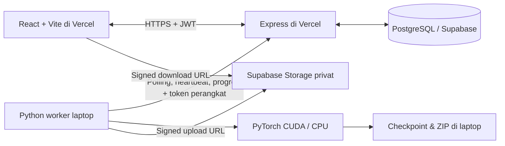

# Arsitektur prototipe

Semua permintaan worker dimulai dari laptop. Backend tidak membuka koneksi langsung ke localhost pengguna. Tidak ada tunnel, port forwarding, subprocess training di Vercel, atau ketergantungan pada filesystem Vercel. Backend hanya mengelola metadata dan izin.

## Siklus tugas

1. Pengguna login dengan JWT 8 jam, mendaftarkan perangkat, dan mengunduh worker.json yang berisi token perangkat sekali.
2. Token hanya hash SHA-256 di database. Token asli tersimpan pada laptop, bukan frontend environment.
3. Worker mengirim kemampuan GPU/CPU dan heartbeat. Website menganggap offline setelah 45 detik tanpa heartbeat.
4. Permintaan training membuat job queued yang menarget perangkat milik pengguna. Perangkat offline boleh memiliki antrean.
5. Worker meminta satu job. Transaksi PostgreSQL mengunci baris worker dan job agar request konkuren lintas instance Vercel tidak menjalankan dua job pada perangkat yang sama.
6. Klaim memberikan token lease acak. Backend hanya menyimpan hash; lease berlaku 180 detik. Heartbeat progres memperpanjangnya.
7. Nomor urut progres mencegah permintaan lama menimpa progres yang lebih baru.
8. Cancellation queued langsung membatalkan job. Cancellation running disampaikan melalui respons progres dan diperiksa trainer pada batas batch.
9. Worker menyimpan file lokal dan mengirim hasil akhir. Completion yang diulang setelah respons hilang bersifat idempotent.
10. Bila Storage aktif, model ZIP diunggah langsung melalui signed URL. Backend memastikan objek ada sebelum menyimpan referensi unduhan. URL unduh hanya berlaku 60 detik dan diberikan setelah pemeriksaan pemilik.

Worker menjalankan satu proses trainer, dan lock file membatasi satu worker aktif per folder. Token perangkat yang sama tidak boleh digunakan oleh beberapa instalasi laptop. Setiap laptop harus didaftarkan sendiri.

## Saat koneksi gagal

- Antrean dan status berada di PostgreSQL, sehingga survive restart/scale Vercel.
- Worker mencoba kembali request jaringan. Jika tidak mendapat acknowledgment progres selama sekitar 140 detik, training dihentikan.
- Lease kedaluwarsa menjadi interrupted saat endpoint daftar/klaim berikutnya dipanggil; tidak membutuhkan timer dalam serverless.
- Job interrupted tidak diklaim ulang otomatis. Ini menghindari duplikasi komputasi. Buat eksperimen baru setelah memeriksa hasil lokal.
- Menutup worker normal meminta pembatalan; jika proses trainer macet, worker menghentikannya setelah masa tunggu.
- Bila parent worker dimatikan paksa, watchdog trainer meminta pembatalan setelah file heartbeat lokal kedaluwarsa.
- Tidak ada resume otomatis, retry training otomatis, scheduler GPU multi-proses, atau unggah ulang artefak otomatis setelah lease habis.

## Pemisahan data dan izin

User, Worker, dan Job memiliki RLS aktif untuk menutup akses anonim melalui PostgREST Supabase. Prisma memakai koneksi database server yang berwenang. Akses aplikasi dibatasi ownerId pada setiap endpoint dashboard. Model di bucket privat. Service-role Supabase dan DATABASE_URL hanya pada backend.

Akun prototipe memakai tabel User sendiri di database khusus. JWT prototipe tidak kompatibel otomatis dengan JWT produksi EIS: issuer/audience dan secret berbeda. Penggabungan ke EIS kelak memerlukan pemetaan pengguna/middleware secara eksplisit.

CORS membatasi origin dashboard; JWT/token tetap diperlukan karena CORS bukan autentikasi. Tidak ada endpoint upload kode Python, perintah shell, path dataset arbitrer, atau model tak dikenal. Error API tidak mengembalikan credential atau stack trace.

Dataset demo berada di laptop. Konfigurasi, metrik, contoh prediksi digit, dan status dikirim ke API. ZIP dikirim ke Supabase hanya bila backend Storage dikonfigurasi. Untuk data EIS sensitif, putuskan kebijakan upload dan publikasikan hanya keluaran berizin.

## Kontrak model yang perlu diganti

trainer.py menerima satu folder job dengan status.json dan config: epochs, batch_size, learning_rate, seed, device. Trainer memperbarui history, epoch, pesan, metrik dan hasil; worker memfilter field sebelum dikirim ke API. Parameter final kedua model EIS dapat berbeda dan harus mengikuti implementasi Wahhab/Syafiq.

Tidak semua model capung memerlukan PyTorch/GPU. Arsitektur worker dapat menjalankan library lain, tetapi implementasi demo hanya menjalankan trainer yang dibundel dan dipercaya.

## Batas operasional prototipe

Daftar job dibatasi 100 terbaru, belum ada pagination/hapus/retensi. Akun belum memiliki UI reset kata sandi atau manajemen role. Belum ada backoff polling adaptif (worker idle 5 detik; dashboard 2,5 detik), sehingga penggunaan API online akan bertambah selama proses dibuka. Tambahkan pemantauan dan batas biaya sebelum penggunaan terus-menerus. Artefak demo kecil; pipeline multipart/resumable untuk checkpoint besar belum dibuat.
