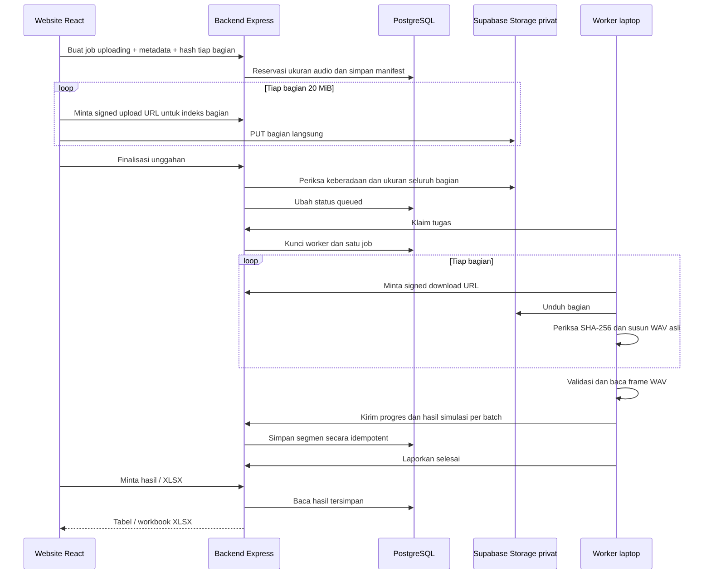

# Identifikasi suara burung — prototipe simulasi

> Pembaruan 26 November 2026: model burung sementara dan input WAV/MP3 telah diintegrasikan. Panduan terkini ada pada [INTEGRASI-MODEL-BURUNG.md](INTEGRASI-MODEL-BURUNG.md). Isi berikut mencatat tahap implementasi sebelumnya; keterangan simulasi dan versi worker lama adalah konteks historis.


Implementasi: 13 November 2026. Model Syafiq belum tersedia. Seluruh label spesies dan nilai keyakinan adalah **contoh simulasi**, termasuk tabel dan XLSX. Modul ini menjalankan inferensi simulasi, bukan training model burung.

## Alur pengguna

1. Buka **Identifikasi suara** setelah login.
2. Pilih atau tarik **satu file WAV**. Website memeriksa header, ukuran, dan durasi tanpa memuat seluruh rekaman ke RAM.
3. Periksa nama, durasi, ukuran, kanal, sample rate, dan bit depth. Pemutar lokal tersedia sebelum unggah.
4. Pilih worker laptop. Gunakan paket worker terbaru yang melaporkan `bird_audio_version: 1`.
5. Klik **Mulai identifikasi · simulasi**. Browser menghitung SHA-256 tiap bagian dan mengunggah langsung ke bucket Supabase privat.
6. Pantau unggahan, antrean, unduhan worker, dan pemrosesan. Tombol **Batalkan** tersedia.
7. Setelah selesai, lihat tabel hasil berhalaman dan unduh Excel. Pilih **Identifikasi audio lain** untuk memulai proses baru.
8. Riwayat dapat dibuka kembali setelah tab ditutup. Unggahan yang belum selesai tetap memerlukan file dari browser; jika halaman dimuat ulang, batalkan unggahan lama dan mulai ulang. Jika request upload gagal sementara, tombol coba unggah lagi menggunakan bagian yang sudah tersimpan.

## Batas tahap awal

| Aspek | Implementasi |
| --- | --- |
| Input | RIFF/WAVE PCM tanpa kompresi, mono atau stereo |
| Bit depth | 8, 16, 24, 32 bit integer; float WAV dan RF64 belum didukung |
| Sample rate | 8–192 kHz; tidak ada resampling otomatis |
| Ukuran maksimum | 700 MiB per rekaman |
| Durasi maksimum | 2 jam untuk prototipe |
| Bagian transfer | 20 MiB; bukan pemotongan segmen model |
| Reservasi audio bersamaan | 800 MiB total untuk aplikasi ini, lintas pengguna |
| Segmen demo | 3 detik; segmen terakhir dapat lebih pendek |
| Model | Simulasi deterministik: Contoh spesies A, Contoh spesies B, unknown |
| Eksekusi | Worker Python laptop, CPU untuk simulasi; tidak memerlukan GPU |
| XLSX | Sheet Hasil_Simulasi dan Keterangan; waktu dalam detik dan keyakinan contoh dalam persen |

Batas 700/800 MiB merupakan keputusan implementasi awal agar kuota Free tidak langsung penuh. Reservasi aplikasi tidak menghitung seluruh bucket/model atau trafik lain pada organisasi Supabase. Tetap pantau dashboard Usage. Jika ukuran rekaman melebihi batas, website menolak sebelum unggah; format dan batas akhir dapat berubah setelah model diberikan.

## Arsitektur



File audio tidak melewati body request Vercel. Vercel mengelola request pendek untuk metadata/izin/progres. Worker hanya mengunduh dari signed URL Storage; token worker tidak dikirim ke Storage. File WAV disatukan di disk, bukan RAM. Checksum diperiksa sebelum WAV dibaca. File sementara hasil rekonstruksi di worker dihapus saat tugas berakhir; file asli yang dipilih pengguna tidak diubah.

Antrean training dan audio berbagi penguncian worker. Satu laptop tidak menjalankan keduanya sekaligus. Worker lama tidak mengambil job audio. Dataset demo training tetap tersedia pada menu Eksperimen.

## Retensi 24 jam dan hasil permanen

- Job selesai/dibatalkan/gagal: audio cloud kedaluwarsa 24 jam setelah status akhir disimpan.
- Unggahan atau antrean yang tidak pernah diproses: kedaluwarsa 24 jam sejak dibuat, supaya reservasi tidak tertahan selamanya.
- Job interrupted karena lease habis: audio diberi 24 jam sejak backend menandainya interrupted.
- Endpoint tidak memberikan upload/download ticket setelah audio kedaluwarsa.
- Penghapusan fisik dilakukan melalui Supabase Storage API, bukan menghapus baris storage.objects menggunakan SQL.
- Hasil segmen disimpan di tabel BirdSegment. XLSX dibuat kembali saat diunduh, sehingga tetap tersedia setelah audio dihapus, tanpa menyimpan salinan Excel tambahan pada bucket.
- Penghapusan dijalankan saat riwayat diakses dan melalui endpoint terjadwal. **Tanpa penjadwal, penghapusan fisik bergantung pada trafik aplikasi.**
- Konfigurasikan Supabase Cron tiap 15 menit untuk penghapusan saat website/worker tidak digunakan. Dengan penjadwal sehat, pembersihan dimulai pada eksekusi setelah batas 24 jam dan diproses bertahap sesuai antrean; ini bukan jaminan penghapusan tepat pada milidetik ke-24 jam.
- Pembersihan mencoba ulang objek gagal dihapus. Tombstone diperiksa ulang paling sering satu jam sekali selama 48 jam untuk membersihkan bagian dari signed upload yang sudah terbit tetapi terlambat tiba.
- Signed URL Supabase yang sudah diberikan memiliki masa berlaku sendiri. Download ticket dibatasi maksimal 60 detik atau sisa retensi. Batas akses baru 24 jam tidak membatalkan URL yang masih berlaku secara instan.

## Menyiapkan deployment yang sudah ada

### 1. Migrasi database

Gunakan connection string database **prototipe cloud** pada environment terminal untuk DATABASE_URL dan DIRECT_URL, lalu dari backend jalankan:

```powershell
npm.cmd ci
npm.cmd run db:deploy
```

Migrasi baru: `202611130001_bird_audio`. Migrasi menambah metadata audio pada Job dan tabel BirdSegment dengan RLS. Data training lama tetap jenis training. Jangan menjalankan tes API terhadap cloud; tes dibatasi ke database lokal port 55439.

### 2. Storage privat

Tambahkan pada **backend Vercel**, bukan frontend:

```dotenv
SUPABASE_URL=https://YOUR_PROJECT_REF.supabase.co
SUPABASE_SERVICE_ROLE_KEY=YOUR_SERVER_SIDE_KEY
SUPABASE_AUDIO_BUCKET=bird-audio
CRON_SECRET=RANDOM_SECRET_AT_LEAST_32_CHARACTERS
```

SUPABASE_URL adalah HTTPS project URL, bukan URI PostgreSQL. Service-role key dan CRON_SECRET adalah rahasia backend. Tidak ada kredensial server yang ditaruh pada variabel VITE_*.

Bucket bird-audio harus **private**, batas 20 MiB per objek, MIME application/octet-stream karena objeknya merupakan bagian biner rekaman. Pada Supabase Free, global file size limit tetap maksimal 50 MB; jangan menganggap resumable upload menaikkan batas paket.

Untuk membuat/mengatur bucket dengan environment Storage yang sudah diisi pada terminal, dari backend:

```powershell
npm.cmd run bird:storage
```

Skrip tidak membuat policy publik. Jika bucket dengan nama sama sudah publik, skrip berhenti dan meminta bucket privat baru.

Jika Storage belum dikonfigurasi, halaman menampilkan pesan penyiapan; server menolak unggahan dengan 503. Tidak ada fallback yang berpura-pura menyimpan audio di Vercel.

### 3. Penjadwal penghapusan

Endpoint: `POST https://YOUR_BACKEND/api/internal/audio-cleanup` dengan header `Authorization: Bearer CRON_SECRET`. GET juga diterima untuk kompatibilitas cron. Endpoint tidak memerlukan akun dashboard tetapi memerlukan secret minimal 32 karakter.

Di Supabase, aktifkan Cron/pg_cron dan pg_net. Simpan URL endpoint dan secret di Vault melalui dashboard sebagai `eis_audio_cleanup_url` dan `eis_audio_cleanup_secret`. Jangan commit nilainya. Jalankan SQL berikut setelah secret tersedia:

```sql
select cron.schedule(
  'eis-audio-cleanup',
  '*/15 * * * *',
  $$
  select net.http_post(
    url := (select decrypted_secret from vault.decrypted_secrets where name = 'eis_audio_cleanup_url' limit 1),
    headers := jsonb_build_object(
      'Content-Type', 'application/json',
      'Authorization', 'Bearer ' || (select decrypted_secret from vault.decrypted_secrets where name = 'eis_audio_cleanup_secret' limit 1)
    ),
    body := '{}'::jsonb,
    timeout_milliseconds := 30000
  );
  $$
);
```

Sebelum membuat jadwal, periksa apakah nama jadwal sudah ada; ubah jadwal yang ada, jangan membuat duplikat. Periksa respons endpoint dan riwayat Cron setelah dipasang. URL endpoint harus dapat dijangkau tanpa login Vercel; CRON_SECRET tetap diperiksa oleh aplikasi. Jangan memberikan akses dashboard/database kepada pihak yang tidak berwenang membaca secret.

### 4. Redeploy dan perbarui worker

1. Jalankan build dan deploy backend/frontend menggunakan konfigurasi Vercel yang sudah ada.
2. Jalankan `python scripts/package-worker.py` sebelum commit bila source worker berubah; ZIP dan manifest hasilnya harus ikut dikirim.
3. Hentikan worker lama. Unduh paket worker terbaru dari website, ekstrak ke folder tetap, pasang handler, dan impor koneksi perangkat.
4. Jika memperbarui folder worker proyek yang sama, source terbaru dapat memakai .venv dan worker.json yang sudah tersedia. Jangan menyalin source saat worker masih aktif.
5. Tunggu worker Online. Perangkat perlu melaporkan bird_audio_version: 1 sebelum API menerima tugas audio.
6. Uji WAV kecil dahulu, lalu file di atas 20 MiB, pembatalan, ekspor Excel, dan pembersihan file uji.

Handler dari instalasi berbeda tidak ditimpa diam-diam; gunakan proses uninstall handler lama sebelum pindah folder jika installer memberi pesan konflik.

## Pengujian implementasi

```powershell
# Backend: PostgreSQL lokal :55439 harus aktif
cd backend
npm.cmd run build
npm.cmd test

# Frontend
cd ../frontend
npm.cmd run build

# Dari root prototipe
python scripts/test-bird-worker.py
python scripts/package-worker.py
python scripts/test-launcher.py
```

Tes integrasi menggunakan Storage fixture lokal dan akun uji terisolasi, bukan bucket atau data cloud pengguna. Cakupan meliputi multipart >20 MiB, finalisasi, isolasi pengguna, worker versi lama, antrean gabungan, worker Python, hasil/XLSX, pembatalan dan retensi. Tes fixture tidak membuktikan konfigurasi bucket, CORS Storage, jaringan, maupun penjadwal Supabase live telah benar.

## Integrasi model asli berikutnya

Ganti penghasil label simulasi dalam bird_worker.py dengan adapter model yang dipercaya. Tentukan sample rate, kanal, segmentasi, overlap, label spesies, confidence/unknown, kebutuhan GPU, dan format keluaran bersama Syafiq. Jika kontrak hasil berubah, tambahkan versi kontrak dan migrasi yang sesuai. Hasil simulasi lama tetap harus ditandai sebagai simulasi.

## Referensi layanan (diperiksa 13 November 2026)

- https://supabase.com/docs/guides/storage/uploads/file-limits
- https://supabase.com/docs/guides/storage/serving/bandwidth
- https://supabase.com/docs/guides/cron
- https://supabase.com/docs/guides/cron/quickstart
- https://vercel.com/docs/functions/limitations

### Status verifikasi pada implementasi ini

Build frontend/backend dan tes API serta worker lulus pada lingkungan lokal. Antarmuka pemilihan WAV, pembacaan metadata, tabel hasil tersimpan, dan download XLSX diperiksa melalui browser terhadap API fixture lokal. Audio multipart >20 MiB diproses oleh worker Python pada tes integrasi. Bucket dan penjadwal Supabase live serta deployment Vercel untuk fitur baru ini belum diaktifkan atau diverifikasi.
