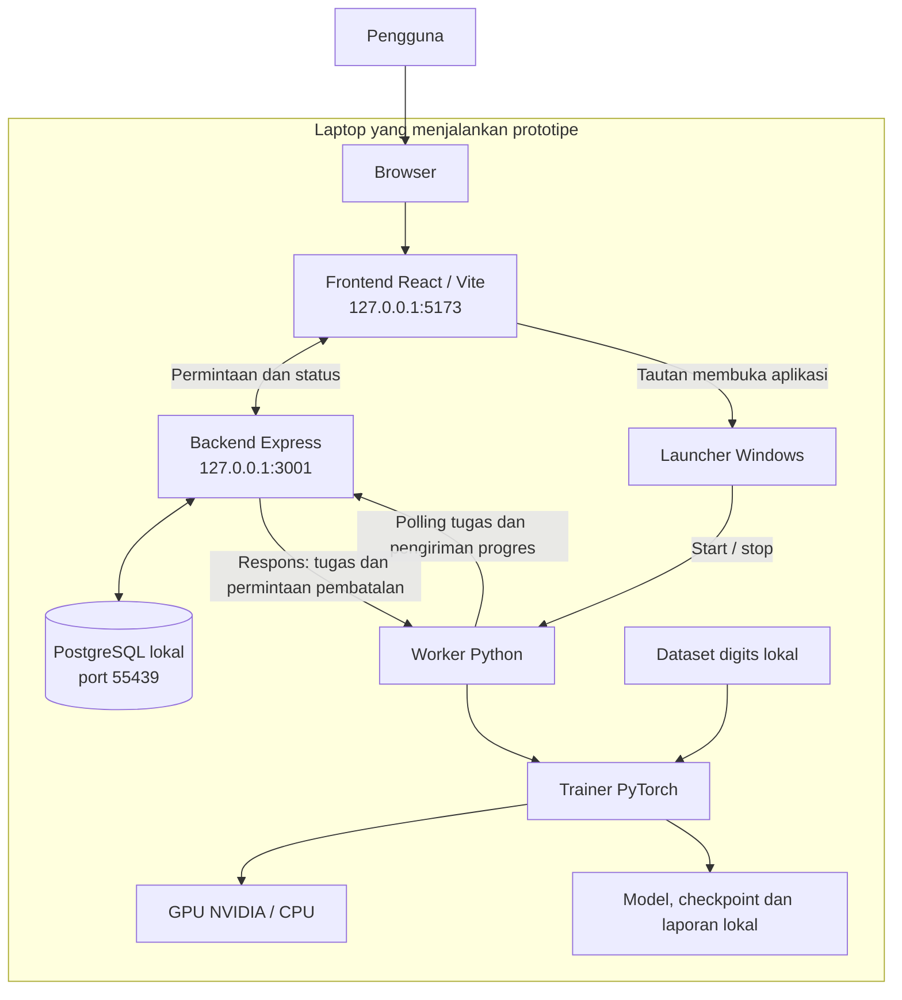
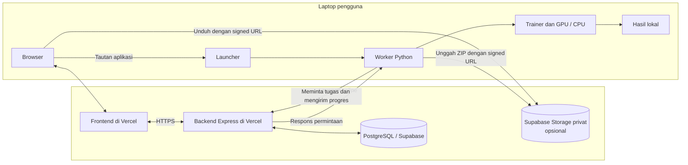
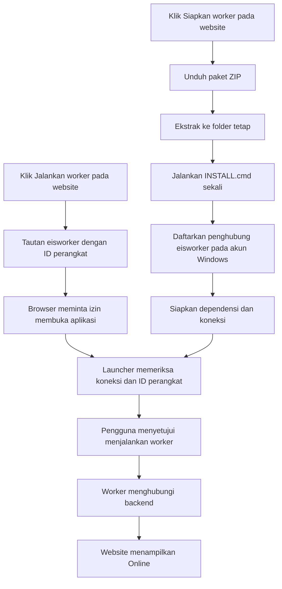
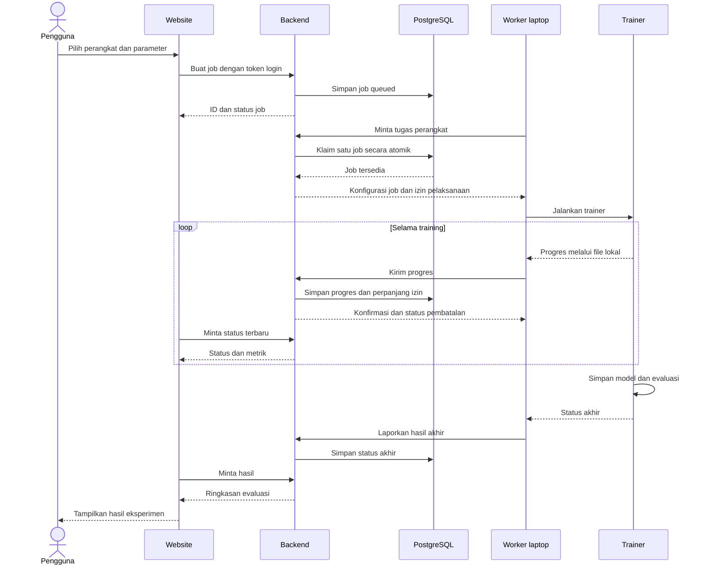
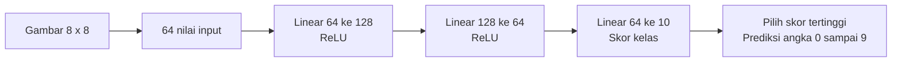
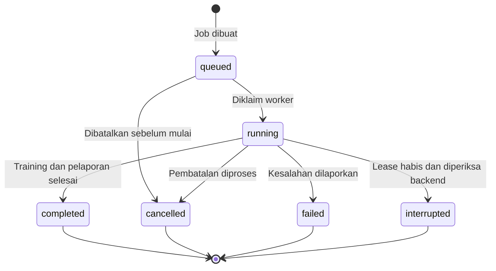
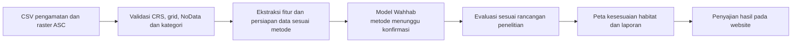

# Cara Kerja Prototipe EIS Training Studio

> Pembaruan 26 November 2026: model burung sementara dan input WAV/MP3 telah diintegrasikan. Panduan terkini ada pada [INTEGRASI-MODEL-BURUNG.md](INTEGRASI-MODEL-BURUNG.md). Isi berikut mencatat tahap implementasi sebelumnya; keterangan simulasi dan versi worker lama adalah konteks historis.

## Bahan presentasi arsitektur website dan worker lokal

Tanggal dokumentasi: 29 Oktober 2026  
Lokasi proyek: `D:\COOLYEAH\TA\EIS\code\prototype`  
Status: prototipe lokal untuk menguji alur training; belum menjadi integrasi model capung atau burung produksi.

## 1. Ringkasan

Prototipe memungkinkan pengguna memulai, memantau, dan menghentikan training melalui website. Komputasi model dilakukan oleh program worker pada laptop menggunakan GPU NVIDIA melalui CUDA atau CPU.

Website mengirim permintaan ke backend. Backend menyimpan tugas dalam database. Worker mengambil tugas untuk perangkatnya, menjalankan trainer, lalu mengirim progres dan hasil evaluasi kembali ke backend. Website membaca pembaruan tersebut untuk ditampilkan kepada pengguna.

**Pesan utama untuk PPT:** website mengatur eksperimen; laptop menjalankan komputasi model.

Model yang digunakan sekarang adalah MLP untuk mengenali angka 0–9. Model ini dipakai untuk membuktikan alur integrasi sistem. MaxEnt dan model capung Wahhab belum diintegrasikan.

## 2. Tujuan prototipe

- Menguji hubungan website, backend, database, dan worker laptop.
- Memungkinkan training dimulai dan dipantau melalui antarmuka web.
- Memanfaatkan GPU/CPU yang tersedia pada laptop pengguna.
- Menyimpan konfigurasi, riwayat eksperimen, dan hasil evaluasi.
- Mempermudah penggunaan worker melalui launcher Windows.
- Menyiapkan dasar integrasi model capung dan burung.

Hasil akurasi model demo bukan ukuran keberhasilan model ekologis EIS.

## 3. Komponen sistem

| Komponen | Teknologi | Tanggung jawab |
|---|---|---|
| Frontend | React 19, TypeScript, Vite, React Router | Login, perangkat, formulir training, progres, dan riwayat |
| Backend/API | Express 5, TypeScript | Autentikasi, otorisasi, validasi parameter, antrean dan status |
| Database | PostgreSQL melalui Prisma | Akun, perangkat, tugas, konfigurasi, dan metrik |
| Launcher Windows | Python 3.12, Tkinter | Setup dependensi, impor koneksi, start/stop worker |
| Worker | Python | Komunikasi API, pengambilan tugas, pengelolaan trainer, pengiriman progres |
| Trainer demo | PyTorch 2.9.1 CUDA 12.6, NumPy, scikit-learn | Persiapan data, training MLP, evaluasi, penyimpanan model |
| Penyimpanan lokal | Folder worker/runs | Model, checkpoint, metrik, laporan, dan ZIP |
| Penyimpanan cloud opsional | Supabase Storage privat | Unggah dan unduh paket model apabila dikonfigurasi |

Launcher, worker, dan trainer merupakan komponen berbeda. Launcher adalah antarmuka desktop; worker mengatur pelaksanaan tugas; trainer melakukan perhitungan model.

## 4. Skema arsitektur saat ini: seluruh sistem lokal

Alamat `127.0.0.1` selalu merujuk komputer tempat program dijalankan. Alamat API tersebut pada laptop pengguna tidak menunjuk laptop pengembang.

Backend tidak melakukan training. Database tidak menyimpan bobot model pada konfigurasi lokal ini.

## 5. Skema target: website online dan worker laptop

Skema berikut menggambarkan rancangan deployment, **bukan layanan cloud yang sudah aktif atau terverifikasi**.

Semua komunikasi API oleh worker dimulai dari laptop. Backend mengembalikan respons pada permintaan tersebut, bukan membuka koneksi masuk ke laptop. Tidak diperlukan public IP atau port forwarding untuk pola ini.

Jika website sudah online, laptop pengguna hanya perlu lingkungan worker dan driver yang sesuai. Node.js serta PostgreSQL lokal diperlukan untuk simulasi seluruh sistem lokal, bukan untuk worker yang terhubung ke backend cloud.

## 6. Setup dan koneksi perangkat

### 6.1 Setup pertama pada laptop baru

1. Pasang prasyarat sesuai skenario lokal atau cloud.
2. Pasang launcher dari folder worker atau paket ZIP website.
3. Klik **Siapkan dependensi** untuk memasang lingkungan Python dan PyTorch.
4. Siapkan koneksi perangkat:
   - Instalasi seluruh sistem lokal melalui `SETUP-LOCAL.cmd` membuat konfigurasi worker otomatis.
   - Alur pendaftaran manual melalui website menghasilkan file koneksi untuk diimpor pada launcher.
5. Jalankan worker.
6. Tunggu status Online dan informasi GPU muncul di website.

File koneksi memuat alamat API dan token perangkat. Token tersebut merupakan kredensial, sehingga tidak boleh dibagikan atau dimasukkan ke bahan presentasi.

### 6.2 Cara tombol launcher bekerja

Tautan aplikasi hanya memuat ID perangkat; tidak memuat token koneksi atau perintah shell.

Browser tidak memasang Python atau menjalankan setup diam-diam. Setup awal tetap memerlukan tindakan pengguna. Tombol tidak menyalakan laptop yang mati dan tidak menghidupkan worker pada laptop lain.

Pembukaan aplikasi melalui browser pengujian otomatis sebelumnya diblokir kebijakan browser. Registrasi handler berhasil, tetapi alur klik browser sampai GUI launcher berjalan belum terverifikasi penuh pada semua browser.

## 7. Alur satu eksperimen training

### 7.1 Langkah pengguna dan sistem

1. **Login:** backend memeriksa akun dan memberikan token akses.
2. **Pilih perangkat:** pengguna memilih laptop yang sudah terdaftar.
3. **Atur training:** pengguna mengisi epoch, batch size, learning rate, seed, dan CPU/GPU.
4. **Buat tugas:** backend memvalidasi izin dan parameter, kemudian menyimpan job berstatus queued.
5. **Ambil tugas:** worker meminta tugas yang ditujukan untuk perangkat tersebut.
6. **Mulai training:** backend mengubah status menjadi running; worker menjalankan trainer.
7. **Pantau progres:** worker mengirim metrik; website mengambil pembaruan dari backend.
8. **Evaluasi:** trainer menguji model terbaik menggunakan data pengujian.
9. **Simpan hasil:** file tersimpan lokal dan ringkasan dilaporkan ke backend.
10. **Lihat riwayat:** pengguna dapat membuka kembali konfigurasi dan hasil eksperimen.

Perangkat offline dapat memiliki tugas mengantre. Tugas baru diproses ketika worker terhubung dan tersedia.

### 7.2 Diagram urutan komunikasi

## 8. Cara training model demo

### 8.1 Dataset

- Dataset: digits bawaan scikit-learn, dimuat dengan `load_digits()`.
- Jumlah: 1.797 gambar grayscale.
- Ukuran gambar: 8 × 8 piksel.
- Label: angka 0 sampai 9.
- Satu gambar diubah menjadi 64 nilai input.
- Nilai piksel dinormalisasi dengan pembagian 16.

Dataset ini otomatis tersedia ketika scikit-learn terpasang. Dataset CSV dan raster capung belum menjadi input trainer ini.

### 8.2 Pembagian data

Kode menyisihkan 20% sebagai test set. Dari 80% sisanya, 20% disisihkan untuk validasi. Proporsi keseluruhan mendekati:

| Bagian | Proporsi | Penggunaan |
|---|---:|---|
| Training | 64% | Memperbarui bobot model |
| Validasi | 16% | Memilih model terbaik selama training |
| Pengujian | 20% | Mengukur hasil akhir model terbaik |

Pembagian memakai seed dan mempertahankan proporsi kelas. Jumlah sampel dibulatkan oleh fungsi pembagian data.

### 8.3 Model dan proses optimasi

Model memakai optimizer Adam dan CrossEntropyLoss. Pada setiap batch, model membuat prediksi, menghitung kesalahan, menghitung gradien, lalu memperbarui bobot.

Setiap epoch selesai, trainer menghitung metrik validasi. Model dengan akurasi validasi tertinggi disimpan sebagai `model.pt`. Setelah seluruh epoch selesai, model terbaik dievaluasi pada test set.

Setiap job memulai model baru dari awal. Penyimpanan checkpoint belum disertai fitur resume pada website.

### 8.4 Parameter

| Parameter | Penjelasan |
|---|---|
| Epoch | Jumlah pengulangan pembelajaran seluruh data training |
| Batch size | Jumlah sampel dalam satu langkah pembaruan bobot |
| Learning rate | Besarnya langkah pembaruan bobot |
| Seed | Mengendalikan sumber acak untuk membantu pengulangan eksperimen |
| Auto | Memilih CUDA jika tersedia, jika tidak menggunakan CPU |
| CPU | Memakai prosesor |
| CUDA | Meminta GPU; training gagal dengan pesan jika CUDA tidak tersedia |

Seed membantu konsistensi, tetapi tidak menjamin hasil identik pada setiap kombinasi perangkat dan lingkungan.

## 9. Pemantauan dan pengelolaan antrean

Sistem memakai polling, yaitu permintaan berulang. Implementasi ini belum memakai WebSocket.

| Mekanisme | Interval/batas nominal | Fungsi |
|---|---|---|
| Worker idle meminta tugas | Sekitar 5 detik | Mengambil pekerjaan berikutnya |
| Worker melaporkan progres | Sekitar 2 detik | Mengirim epoch, loss, akurasi, dan pesan |
| Website mengambil status | Sekitar 2,5 detik | Memperbarui tampilan |
| Perangkat dianggap offline | Lebih dari 45 detik tanpa heartbeat | Memberi indikator koneksi |
| Izin pelaksanaan job (lease) | 180 detik, diperpanjang oleh progres | Membatasi kepemilikan tugas |
| Training tanpa konfirmasi progres | Sekitar 140 detik | Meminta proses berhenti jika API tidak terjangkau |

Waktu nyata dapat lebih lama karena durasi request dan timeout jaringan.

Backend mengunci data saat mengklaim tugas untuk mencegah dua request mengambil pekerjaan secara bersamaan. Satu perangkat hanya memiliki satu job running. Di laptop, lock file juga mencegah dua worker berjalan dari folder instalasi yang sama.

## 10. Status pekerjaan

| Status | Arti |
|---|---|
| queued | Menunggu worker |
| running | Sudah diklaim dan sedang ditangani worker |
| completed | Training selesai dan hasil akhir diterima backend |
| cancelled | Dibatalkan |
| failed | Proses melaporkan kegagalan |
| interrupted | Izin pelaksanaan habis karena progres tidak diperbarui |

Pemeriksaan kedaluwarsa dilakukan saat endpoint terkait diakses. Perubahan menjadi interrupted tidak bergantung pada timer latar yang terus berjalan di Vercel.

Tahap internal trainer seperti starting atau finishing tidak seluruhnya merupakan status job database yang terpisah.

## 11. Penyimpanan dan aliran data

| Data | Lokasi utama |
|---|---|
| Akun, perangkat, token perangkat dalam bentuk hash | Database |
| Konfigurasi job, status, progres, dan metrik | Database |
| Token asli perangkat dan alamat API | File koneksi lokal |
| Dataset demo | Instalasi scikit-learn pada laptop |
| Bobot model, checkpoint, laporan lengkap | Folder hasil laptop |
| ZIP model cloud | Supabase Storage privat jika diaktifkan |

Folder hasil saat proyek berada di lokasi sekarang:

`D:\COOLYEAH\TA\EIS\code\prototype\worker\runs\<job-id>\`

| File | Isi |
|---|---|
| model.pt | Model terbaik berdasarkan akurasi validasi |
| checkpoint.pt | Keadaan model dan optimizer pada epoch terakhir yang selesai |
| metrics.csv | Metrik per epoch |
| report.json | Konfigurasi dan laporan evaluasi |
| hasil-training.zip | Paket hasil |
| status.json | Progres lokal yang dibaca worker |
| worker.log / error.log | Catatan proses atau kesalahan, jika tersedia |

File model/checkpoint mungkin belum ada jika proses dihentikan sebelum epoch pertama selesai.

Konfigurasi, metrik, dan contoh prediksi digit dikirim ke API. Karena itu, pernyataan “seluruh data tidak pernah keluar dari laptop” tidak tepat. Untuk integrasi EIS, isi metadata dan hasil yang dikirim harus mengikuti kebijakan data.

Jika Storage diaktifkan, worker mengunggah ZIP langsung ke Storage memakai URL sementara. File besar tidak melewati body request backend Vercel.

## 12. Pembatalan dan gangguan

| Kejadian | Perilaku |
|---|---|
| Tab website ditutup | Training tetap berjalan apabila worker dan layanan pendukung tetap aktif |
| Terminal START-LOCAL ditutup / Enter ditekan | Frontend dan backend yang dikelolanya berhenti; worker kehilangan akses API |
| Backend belum aktif | Worker mencoba terhubung kembali setiap sekitar 10 detik |
| Job queued dibatalkan | Backend langsung membatalkannya |
| Job running dibatalkan | Worker menerima permintaan melalui respons progres; trainer memeriksa tanda pembatalan pada batas batch |
| Worker dihentikan melalui launcher | Worker meminta trainer berhenti; hasil epoch lengkap tetap disimpan |
| Jaringan cloud terputus lama | Training dihentikan dan status dapat menjadi interrupted setelah lease berakhir |
| Laptop sleep, mati, atau proses dipaksa berhenti | Eksekusi terputus; tidak ada resume otomatis |
| Upload ZIP cloud gagal | Model tetap tersedia lokal; ketersediaan unduhan cloud bergantung keberhasilan upload |

Hasil parsial tidak berarti model telah selesai dievaluasi. Metrik test akhir normalnya tersedia setelah training selesai.

## 13. Keamanan dasar yang sudah diterapkan

- Login pengguna dan pemeriksaan kepemilikan perangkat/tugas pada backend.
- Token perangkat berbeda dari token login pengguna.
- Hash token perangkat disimpan di database.
- Parameter training divalidasi sebelum job dibuat.
- Launcher memvalidasi ID perangkat dan file koneksi.
- Tautan launcher tidak membawa token atau perintah yang dapat dieksekusi bebas.
- Worker hanya menjalankan trainer yang dibundel dalam proyek.
- Model cloud, bila digunakan, ditempatkan pada bucket privat dengan akses sementara.

Ini merupakan kontrol prototipe; tidak menyatakan bahwa seluruh kebutuhan keamanan dan operasional produksi sudah selesai.

## 14. Yang sudah tersedia dan yang belum

| Area | Status |
|---|---|
| Website login, perangkat, eksperimen, dan riwayat | Tersedia |
| Antrean database dan worker lokal | Tersedia |
| Training MLP menggunakan CPU/CUDA | Tersedia; CUDA pernah diuji pada laptop pengembang |
| Launcher setup/import/start/stop | Diimplementasikan; alur GUI browser belum terverifikasi penuh |
| Model MaxEnt | Belum diintegrasikan |
| Training capung dari CSV dan raster ASC | Belum diintegrasikan |
| Training/analisis audio burung | Belum diintegrasikan |
| Preprocessing Excel, peta habitat, ancaman, rekomendasi | Belum diimplementasikan pada prototipe ini |
| Resume checkpoint melalui website | Belum tersedia |
| Deployment Vercel dan Storage cloud aktif | Belum diverifikasi pada akun tujuan |
| Pengujian langsung pada NVIDIA T1200 pengguna | Belum dilakukan |

Kecocokan perangkat secara teknis berbeda dari keberhasilan pengujian langsung di perangkat tersebut.

## 15. Integrasi model capung selanjutnya

Bagian yang perlu disesuaikan adalah input dataset, validasi, parameter, kode trainer, evaluasi, format keluaran, dan tampilan peta. Sistem login, perangkat, antrean, dan pengiriman progres dapat menjadi dasar integrasi.

Informasi yang masih diperlukan dari Wahhab meliputi CRS/EPSG, legenda LULC, satuan variabel, pilihan slope atau roughness, metode model, kode training, serta rancangan background/pseudo-absence dan evaluasi.

GPU tidak wajib untuk semua algoritma. Jika model menggunakan implementasi CPU, worker tetap dapat menjalankannya setelah integrasi yang sesuai.

## 16. Susunan materi PPT yang disarankan

| Slide | Judul | Isi utama | Visual |
|---|---|---|---|
| 1 | EIS Training Studio | Tujuan prototipe dan komputasi laptop | Ringkasan satu kalimat |
| 2 | Kebutuhan pengguna | Training melalui website dan penggunaan worker yang lebih mudah | Alur pengguna |
| 3 | Komponen sistem | Frontend, backend, database, launcher, worker, trainer | Tabel bagian 3 |
| 4 | Arsitektur lokal | Semua layanan berjalan pada laptop | Diagram bagian 4 |
| 5 | Setup perangkat | Setup sekali, koneksi, start worker | Diagram bagian 6 |
| 6 | Alur eksperimen | Buat job, antrekan, ambil, latih, laporkan | Diagram urutan bagian 7 |
| 7 | Model demonstrasi | Dataset digits, MLP, train/validation/test | Diagram bagian 8 |
| 8 | Progres dan status | Polling, satu job per perangkat, status pekerjaan | Diagram bagian 10 |
| 9 | Hasil dan gangguan | Model lokal, laporan, pembatalan, koneksi terputus | Tabel bagian 11–12 |
| 10 | Pengembangan berikutnya | Deployment cloud dan integrasi model capung/burung | Diagram bagian 5 atau 15 |

**Narasi pembuka:**
“Prototipe ini menghubungkan antarmuka web dengan komputasi pada laptop pengguna. Pengguna mengatur eksperimen melalui website, sementara worker mengambil tugas dan menjalankan training menggunakan GPU atau CPU lokal.”

**Narasi penutup:**
“Alur website, antrean, worker, dan pelaporan telah dibangun menggunakan model demonstrasi. Tahap berikutnya adalah mengintegrasikan metode serta format data model capung dan burung, kemudian memvalidasinya bersama pengembang model dan pengguna.”

## 17. Cara menggunakan skema untuk PPT

Diagram ditulis dalam blok Mermaid. Gunakan editor Markdown yang mendukung Mermaid untuk melihat tampilannya, lalu ekspor diagram menjadi SVG atau PNG untuk dimasukkan ke PowerPoint. PowerPoint tidak otomatis mengubah kode Mermaid menjadi diagram.

Untuk menggambar ulang secara manual:
- Kotak: aplikasi, komponen, atau langkah proses.
- Silinder: database atau penyimpanan.
- Panah: arah permintaan atau perpindahan data, sesuai label.
- Bingkai besar: batas laptop atau layanan cloud.

Pisahkan skema lokal dan cloud pada slide berbeda agar kondisi implementasi saat ini tidak tercampur dengan target deployment.

## 18. Acuan kode

Dokumen ini disusun dari pemeriksaan implementasi prototipe, terutama:

- `frontend/src/App.tsx`: login, pengambilan status, dan halaman eksperimen.
- `frontend/src/components/Devices.tsx`: setup, koneksi perangkat, tombol launcher.
- `frontend/src/services/api.ts`: komunikasi frontend ke API.
- `backend/src/services/jobs.ts`: klaim tugas, lease, progres, dan kedaluwarsa.
- `worker/launcher.py` dan `worker/launcher_core.py`: antarmuka dan kontrol worker.
- `worker/worker.py`: polling, eksekusi trainer, pelaporan, pembatalan, dan upload.
- `worker/trainer.py`: dataset digits, MLP, evaluasi, dan penyimpanan hasil.
- `docs/ARCHITECTURE.md` dan `docs/WORKER-LAUNCHER.md`: dokumentasi teknis pendukung.

Seluruh path relatif di bagian ini mengacu pada folder proyek yang tercantum pada awal dokumen. Tidak ada kredensial atau token nyata yang disertakan.
