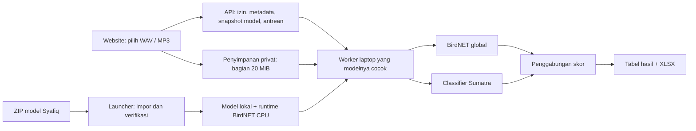

# Integrasi model burung sementara

Integrasi ini memakai paket `sumatra_model_inference_package.zip` dari Syafiq.
Model tersebut **sementara**, dengan 272 label. Paket hanya menyediakan inference;
training/retraining model burung belum diimplementasikan karena kode training
belum disertakan. Fitur eksperimen training yang sudah ada tetap merupakan demo
digits, bukan training model burung.

## Menjalankan pada laptop

1. Gunakan paket worker terbaru. Ekstrak ke folder tetap yang pendek, misalnya
   `D:\EIS-Worker`, lalu buka `INSTALL.cmd`. Jangan menjalankan dari dalam ZIP.
2. Klik **Siapkan dependensi** untuk worker utama. Python 3.12 dengan Tcl/Tk
   diperlukan; environment PyTorch yang sudah ada tetap digunakan.
3. Klik **Impor ZIP model burung**, lalu pilih ZIP Syafiq. Launcher hanya mengambil
   model `.tflite` dan daftar label. Kode Python dari ZIP tidak dijalankan.
4. Klik **Siapkan model burung (CPU)**. Instalasi awal memerlukan internet untuk
   dependensi dan model dasar BirdNET serta ruang disk beberapa GB. Dependensi
   BirdNET/TensorFlow berada pada `.bird-venv`, terpisah dari PyTorch `.venv`.
5. Impor file koneksi perangkat dari website, kemudian **Jalankan worker**.
   Halaman Perangkat akan menampilkan kesiapan model setelah heartbeat terbaru.
6. Buka **Identifikasi suara**, pilih satu WAV PCM atau MP3, lalu pilih perangkat
   yang modelnya siap dan mulai identifikasi. Laptop dan launcher harus tetap aktif.
7. Hasil tampil pada tabel dan dapat diunduh sebagai XLSX. Untuk hasil di atas
   10.000 baris, pilih dan unduh seluruh bagian Excel.

Model tetap disimpan lokal. Tahap ini tidak menyediakan unduhan model otomatis
dari Supabase; ZIP dibagikan dan diimpor secara lokal sesuai pilihan pengguna.
Paket worker yang diunduh dari website tidak menyertakan model, token, rekaman,
environment Python, atau hasil pengguna.

## Alur

## Perilaku analisis

- WAV PCM mono/stereo 8/16/24/32-bit dan MP3 mono/stereo, 8–192 kHz;
  batas prototipe tetap 700 MiB dan 2 jam per file.
- Metadata durasi MP3 dari browser diperiksa ulang oleh decoder worker sebelum
  hasil disimpan. Pembacaan codec yang gagal berarti proses gagal, bukan tanpa deteksi.
- Runtime versi ini memakai **CPU**, termasuk pada laptop dengan GPU NVIDIA.
  Dukungan CUDA untuk demo training PyTorch tidak berarti inference BirdNET
  otomatis memakai GPU.
- BirdNET memproses jendela 3 detik tanpa overlap. Segmen akhir yang pendek tetap
  dianalisis dengan padding nol; waktu akhir yang ditampilkan tidak melewati
  durasi rekaman. Pengaturan ini mencakup tail di bawah 1 detik yang biasanya
  dapat dilewati oleh konfigurasi bawaan BirdNET.
- Seperti skrip Syafiq, kedua pass mengambil kandidat dengan ambang 0,05.
  Untuk spesies pada kedua daftar label, skor akhir adalah
  `global + 0,35 × custom × (1 − global)`. Spesies yang hanya ada di daftar custom
  memakai skor custom; spesies lainnya memakai skor global. Skor akhir minimal
  0,25 ditampilkan. Nilai ini belum menjadi hasil evaluasi akurasi.
- Beberapa spesies dapat muncul pada waktu yang sama; hasil tidak dibatasi pada
  satu spesies terbaik per segmen.
- **Tidak ada deteksi**: tidak ada hasil yang melewati ambang. Confidence
  ditampilkan kosong, bukan seolah-olah angka 0% merupakan akurasi.
- **unknown** hanya digunakan apabila label hasil model memang `unknown`.
  Tahap ini belum menambahkan metode khusus untuk mendeteksi spesies di luar
  kelas yang dikenal. Tidak ada deteksi tidak otomatis menjadi unknown dan
  tidak membuktikan bahwa tidak ada burung.
- Tidak ada filter lokasi/minggu pada antarmuka tahap ini. Model bukan jaminan
  identifikasi seluruh jenis burung di seluruh wilayah.

## Data, versi, dan pembatalan

ID model berasal dari SHA-256 gabungan model dan label. Setiap tugas menyimpan
snapshot model serta parameter analisis. Worker lama atau worker dengan model
berbeda tidak mengambil tugas inference tersebut. Hasil simulasi lama tetap
diberi penanda SIMULASI.

Worker mengirim heartbeat/progres selama subprocess inference bekerja dan
menghentikannya bila dibatalkan atau lease tidak dapat dipertahankan. Subprocess
juga mengawasi proses induknya. Hasil harus mencakup seluruh jendela waktu sebelum
pekerjaan dapat dinyatakan selesai. Kegagalan tidak diperlakukan sebagai keberhasilan
tanpa deteksi.

Audio unggahan tetap memakai Storage privat, bagian 20 MiB, checksum, pemeriksaan
kepemilikan, dan retensi 24 jam yang sudah ada. Salinan audio sementara worker
dihapus setelah proses; rekaman asli di laptop pengguna tidak dihapus. Tabel hasil,
XLSX, dan diagnostik lokal tetap tersedia. Diagnostik lokal berada pada
`worker/bird-runs/<id>/`, termasuk `inference.log`, CSV kedua pass, dan
`inference-result.json`. Jangan membagikan folder tersebut tanpa memeriksa isinya.

Model dan label tersimpan pada `worker/bird-models/<sha256>/`. File tersebut
diabaikan Git. Mengimpor model tidak otomatis mengaktifkan atau mengiklankan
kesiapannya; persiapan runtime harus berhasil terlebih dahulu.

## Penerapan ke website

Migrasi `20261126090000_bird_model_inference` menambahkan kolom hasil tanpa
menghapus data lama. Build frontend/backend dan paket worker perlu dirilis
bersama. CI/CD pada `main` menerapkan migrasi sebelum deployment. Integrasi
ini tidak memerlukan secret atau bucket model baru.

Ekspor XLSX berisi sel teks/angka, tanpa formula tautan file lokal dari paket
asal. Rekaman tidak dimasukkan ke XLSX. Ekspor potongan audio ber-confidence
tinggi dari skrip asal belum disediakan pada website tahap ini.

## Verifikasi

Pengujian CI menggunakan fixture ringan untuk autentikasi, lease, kepemilikan,
kompatibilitas worker/model, multipart, pembatalan, retensi, metadata MP3, beberapa
deteksi per jendela, perbedaan unknown/tanpa deteksi, kelengkapan hasil, dan XLSX.
Pengujian impor ZIP dan rumus fusion tidak mengunduh TensorFlow/model di CI.
Uji inference dengan model asli perlu dilakukan pada runtime lokal; keberhasilan
eksekusi tersebut tidak menggantikan evaluasi ilmiah oleh Syafiq.

Verifikasi lokal pada 26 November 2026 telah menjalankan model asli pada potongan
30,5 detik dari sampel `audio.zip`, baik WAV maupun MP3. Kedua format menghasilkan
11 jendela waktu yang lengkap, termasuk tail 0,5 detik. Seluruh hasil pada potongan
tersebut berada di bawah ambang akhir 0,25, sehingga ditampilkan sebagai
**Tidak ada deteksi**. Hasil ini memverifikasi eksekusi dan pengolahan keluaran;
tidak digunakan sebagai bukti akurasi atau kebenaran keberadaan spesies.

Antarmuka browser juga diperiksa dengan API fixture untuk pemilihan kedua format,
pengiriman mode inference, tabel beberapa spesies, unknown/tanpa deteksi, serta
tombol XLSX. Fixture tampilan tersebut berbeda dari hasil inference sampel asli.
