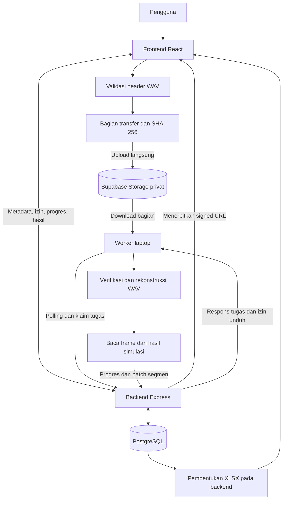
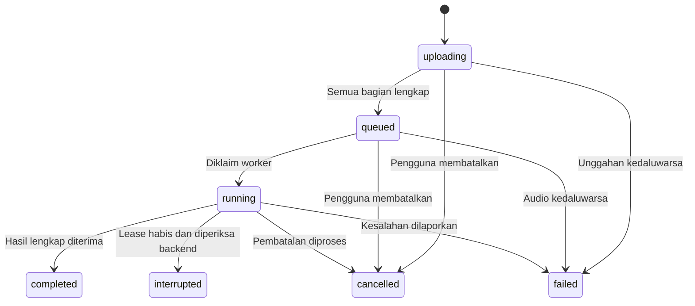

# Laporan Teknis Implementasi Modul Identifikasi Suara Burung

Tanggal penyusunan: **13 November 2026**  
Proyek: **Prototipe EIS Training Studio**  
Lokasi proyek: `D:\COOLYEAH\TA\EIS\code\prototype`  
Tujuan dokumen: bahan pelaporan perkembangan implementasi kepada pembimbing.

## 1. Ringkasan dan status implementasi

Modul identifikasi suara burung menyediakan alur pemilihan satu rekaman WAV melalui website, unggahan ke penyimpanan privat, antrean pekerjaan, pemrosesan melalui worker laptop pengguna, pemantauan progres, pembatalan, penyimpanan hasil per segmen, dan ekspor XLSX.

Implementasi saat ini merupakan **pipeline pengolahan audio dengan simulasi keluaran model**. File benar-benar divalidasi, ditransfer, disusun kembali, dan dibaca worker. Namun, identitas spesies dan nilai keyakinan masih dihasilkan oleh fungsi simulasi deterministik karena model dari Syafiq belum tersedia.

Pencapaian yang sudah dapat dilaporkan adalah implementasi dan pengujian integrasi sistem. Akurasi identifikasi spesies, kemampuan mengenali suara burung, dan performa model asli belum dapat diklaim.

## 2. Kebutuhan dan keputusan rancangan

| Aspek | Keputusan implementasi |
| --- | --- |
| Alur antarmuka | Unggah audio → mulai identifikasi → tunggu proses → ambil hasil |
| Jumlah file | Satu rekaman per pekerjaan |
| Format awal | WAV PCM tanpa kompresi |
| Lokasi komputasi | Worker pada laptop pengguna |
| Penyimpanan audio | Supabase Storage privat |
| Transfer file besar | Bagian biner maksimal 20 MiB, disatukan kembali di worker |
| Retensi audio | 24 jam setelah pekerjaan berakhir; unggahan/antrean terbengkalai memiliki batas sejak dibuat |
| Penyimpanan hasil | Database PostgreSQL |
| Ekspor | XLSX dari hasil database |
| Model sementara | Simulasi dengan penanda pada antarmuka dan workbook |

Tampilan mengikuti struktur low-fi dari tim UI/UX dengan gaya visual prototipe EIS yang sudah digunakan.

## 3. Komponen dan teknologi

| Komponen | Teknologi | Tanggung jawab |
| --- | --- | --- |
| Frontend | React, TypeScript, Vite | Pemilihan file, metadata, unggahan langsung, pemilihan worker, progres, riwayat, dan tabel |
| Backend/API | Express, TypeScript, Zod | Autentikasi, otorisasi, validasi, izin transfer, antrean, penerimaan hasil, dan ekspor |
| Database | PostgreSQL dan Prisma | Metadata pekerjaan, status, konfigurasi, manifest, serta hasil per segmen |
| Object storage | Supabase Storage | Menyimpan bagian-bagian audio secara privat |
| Worker | Python | Klaim pekerjaan, unduh, verifikasi checksum, rekonstruksi WAV, pembacaan segmen, dan pelaporan |
| Launcher | Python dan Tkinter | Mengimpor koneksi serta menjalankan/menghentikan worker |
| Ekspor Excel | OOXML dalam paket ZIP | Membentuk workbook XLSX pada backend saat diminta |

Simulasi pengolahan WAV menggunakan CPU. Paket worker juga memiliki PyTorch untuk fitur training yang sudah ada, tetapi modul simulasi audio ini belum melakukan inferensi menggunakan GPU.

## 4. Skema arsitektur



Isi file audio tidak melewati body request backend Vercel. Backend menangani request pendek untuk metadata, izin akses, antrean, progres, dan hasil.

Semua komunikasi API oleh worker dimulai dari laptop. Backend tidak membuka koneksi masuk langsung ke laptop pengguna.

## 5. Validasi dan persiapan WAV

### 5.1 Pemeriksaan pada browser

Frontend membaca struktur RIFF/WAVE menggunakan potongan data berukuran terbatas. Pemeriksaan metadata tidak memerlukan decoding seluruh rekaman panjang ke RAM.

Pemeriksaan meliputi:

- Ekstensi dan identitas RIFF/WAVE.
- Ukuran RIFF dan kelengkapan struktur chunk.
- Jenis encoding PCM.
- Jumlah kanal, sample rate, bit depth, byte rate, dan block alignment.
- Ukuran data audio, jumlah frame, serta konsistensi durasi.
- Batas ukuran dan durasi yang ditentukan aplikasi.

### 5.2 Batas awal

| Parameter | Nilai |
| --- | --- |
| Kanal | Mono atau stereo |
| Bit depth | 8, 16, 24, atau 32 bit integer |
| Sample rate | 8–192 kHz |
| Ukuran rekaman | Maksimal 700 MiB |
| Durasi | Maksimal 2 jam |
| Ukuran bagian transfer | Maksimal 20 MiB |
| Reservasi audio aplikasi | Maksimal 800 MiB secara keseluruhan untuk audio yang belum dibersihkan |

Batas 700/800 MiB merupakan keputusan implementasi awal. Reservasi aplikasi tidak menghitung seluruh pemakaian bucket lain maupun seluruh trafik organisasi Supabase, sehingga pengelola tetap perlu memantau penggunaan layanan.

Float WAV, RF64, dan format terkompresi belum didukung pada tahap ini. Belum diterapkan resampling, pengurangan noise, normalisasi audio, atau ekstraksi fitur. Tahapan tersebut perlu mengikuti spesifikasi model asli.

### 5.3 Perhitungan durasi

Durasi dihitung dari metadata WAV:

```text
durasi_detik = jumlah_frame / sample_rate
```

Metadata browser diperiksa kembali oleh worker setelah file diterima. Validasi browser membantu pengalaman pengguna, sedangkan validasi backend dan worker menjaga konsistensi proses.

## 6. Unggahan file secara bertahap

### 6.1 Pembagian file dan manifest

Browser menggunakan `File.slice()` untuk membaca dan membagi rekaman menjadi bagian maksimal 20 MiB. Setiap bagian dihitung checksum SHA-256 menggunakan Web Crypto API.

Contoh:

```text
Rekaman 60 MiB
    ├── Bagian 0: 20 MiB
    ├── Bagian 1: 20 MiB
    └── Bagian 2: 20 MiB
```

Manifest memuat nama file, ukuran total, metadata WAV, dan daftar hash bagian. Pembagian biner mempertahankan byte asli rekaman; tidak mengubah kualitas suara atau sample rate.

Bagian transfer ini berbeda fungsi dari segmen waktu yang digunakan pada tahap pemrosesan.

### 6.2 Transfer langsung ke Storage privat

Backend memeriksa kepemilikan perangkat serta reservasi ruang, kemudian membuat pekerjaan dengan status `uploading`.

Browser meminta signed upload URL per indeks bagian, kemudian melakukan HTTP PUT langsung ke Storage. Nama objek menggunakan struktur ID pemilik, ID pekerjaan, dan indeks bagian sehingga tidak bergantung pada nama file asli pengguna.

Unggahan memiliki percobaan ulang terbatas. Bagian yang sudah tersimpan dengan ukuran sesuai dapat dilewati saat pengguna mencoba melanjutkan unggahan yang sama. Mekanisme ini merupakan unggahan bertahap milik aplikasi; bukan implementasi protokol TUS.

Jika halaman dimuat ulang saat unggahan belum selesai, pemilihan file browser tidak dipulihkan otomatis. Pengguna dapat membatalkan unggahan lama dan memulai proses baru.

### 6.3 Finalisasi

Backend memeriksa keberadaan dan ukuran semua objek bagian sebelum mengubah pekerjaan menjadi `queued`. Finalisasi tidak membuktikan isi audio benar; verifikasi SHA-256 dan pemeriksaan WAV dilakukan oleh worker setelah download.

## 7. Pengelolaan pekerjaan dan worker

### 7.1 Antrean bersama

Tugas audio menggunakan tabel Job yang juga dipakai oleh fitur training, dengan pembeda `kind = 'bird'`.

Klaim pekerjaan menggunakan transaksi PostgreSQL dan penguncian baris worker serta pekerjaan. Mekanisme ini membatasi satu pekerjaan running pada satu worker, sehingga training dan identifikasi tidak berjalan bersamaan pada perangkat yang sama.

Worker memproses pekerjaan yang ditujukan kepada ID perangkatnya. Pekerjaan tidak otomatis dialihkan ke perangkat lain.

### 7.2 Versi kemampuan worker

Worker baru melaporkan `bird_audio_version: 1` melalui heartbeat. Backend menggunakan informasi ini untuk memastikan perangkat memahami tugas audio.

Worker lama tidak mengambil pekerjaan burung. Pengguna perlu memperbarui paket worker sebelum memakai fitur baru.

### 7.3 Status pekerjaan



### 7.4 Lease dan urutan progres

Pekerjaan yang diklaim mendapatkan lease, yaitu izin pelaksanaan sementara selama 180 detik. Hash lease disimpan pada backend, sedangkan nilai aslinya diberikan kepada worker.

Pelaporan progres memperpanjang lease. Nomor urut progres mencegah request lama menimpa progres yang lebih baru. Jika lease telah habis, worker tidak boleh melanjutkan pengiriman hasil seolah-olah masih memiliki pekerjaan.

Pemeriksaan kedaluwarsa dilakukan ketika endpoint terkait diakses; bukan melalui proses latar permanen di Vercel.

## 8. Rekonstruksi dan pemrosesan pada laptop

### 8.1 Download dan pemeriksaan integritas

Worker meminta signed download URL dari backend untuk setiap bagian. Token worker hanya dikirim ke API, tidak diteruskan ke Storage.

Saat mengunduh, worker:

1. Membatasi jumlah byte sesuai ukuran manifest.
2. Menghitung SHA-256 bagian yang diterima.
3. Membandingkannya dengan hash pada manifest.
4. Menyatukan bagian secara berurutan pada file sementara di disk.
5. Memeriksa WAV melalui modul Python `wave`.
6. Mencocokkan kanal, sample rate, bit depth, jumlah frame, dan durasi dengan metadata unggahan.

Proses gagal jika file tidak lengkap, checksum berbeda, atau WAV tidak sesuai. Rekonstruksi di disk mengurangi kebutuhan RAM dibanding memuat seluruh rekaman besar sekaligus.

### 8.2 Segmentasi demo

Worker membaca frame audio dalam rentang 3 detik. Segmen terakhir mengikuti durasi yang tersisa.

Contoh untuk audio 7,5 detik:

| Urutan | Mulai | Selesai |
| --- | ---: | ---: |
| 0 | 0 detik | 3 detik |
| 1 | 3 detik | 6 detik |
| 2 | 6 detik | 7,5 detik |

Jumlah segmen:

```text
jumlah_segmen = ceil(durasi_detik / 3)
```

Ukuran segmen 3 detik adalah konfigurasi simulasi. Ukuran final, overlap, dan aturan segmentasi model belum ditetapkan.

### 8.3 Penghasil keluaran simulasi

Fungsi simulasi menghasilkan label dan keyakinan berdasarkan urutan segmen dengan pola tetap. Label contoh meliputi `Contoh spesies A`, `Contoh spesies B`, dan `unknown`.

Implikasinya:

- Identitas spesies belum ditentukan dari karakteristik suara.
- Nilai keyakinan belum merupakan probabilitas hasil model.
- Label unknown belum berasal dari threshold atau keputusan model.
- Belum ada ekstraksi spektrogram/MFCC, klasifikasi spesies, atau evaluasi akurasi.
- Penanda SIMULASI ditampilkan pada antarmuka, hasil, dan XLSX.

Perubahan model nantinya harus mempertahankan pembeda yang jelas antara hasil simulasi lama dan hasil model asli.

## 9. Progres, pembatalan, dan gangguan

Worker melaporkan tahap download, pemrosesan segmen, dan penyelesaian. Persentase mencerminkan tahapan implementasi simulasi, bukan estimasi waktu atau akurasi model.

| Mekanisme | Perilaku |
| --- | --- |
| Progres worker | Dikirim sekitar setiap 2 detik saat loop berjalan; dipengaruhi durasi request |
| Pembaruan halaman audio | Polling sekitar setiap 4 detik |
| Heartbeat perangkat selama pemrosesan | Dikirim berkala, sekitar 15 detik |
| Pembatalan | Backend menandai permintaan; worker memeriksanya selama proses |
| Koneksi API lama terputus | Worker menghentikan proses jika sekitar 140 detik tidak mendapat konfirmasi progres |
| Menutup tab setelah unggahan lengkap | Pekerjaan dapat berlanjut jika worker dan layanan pendukung tetap aktif |
| Worker dimulai ulang | Sesi audio sebelumnya ditangani sebagai terputus/gagal; tidak ada resume otomatis |

Kegagalan heartbeat perangkat sesaat tidak langsung membuang progres tugas yang telah dikonfirmasi. Namun, kegagalan autentikasi atau izin tetap menghentikan proses.

Hasil pembatalan diperiksa kembali oleh backend saat completion, sehingga laporan completed yang datang bersamaan dengan permintaan pembatalan tidak mengabaikan pembatalan yang sudah tersimpan.

## 10. Perubahan database dan penyimpanan hasil

Migrasi `202611130001_bird_audio` menambahkan:

| Perubahan | Kegunaan |
| --- | --- |
| Job.kind | Membedakan training dan identifikasi audio |
| Job.audio | Menyimpan manifest dan metadata WAV |
| Job.audioExpiresAt | Batas retensi audio |
| Job.audioDeletedAt | Waktu pembersihan audio tercatat |
| Job.audioCleanupCheckedAt | Waktu pemeriksaan ulang pembersihan |
| Tabel BirdSegment | Menyimpan hasil setiap rentang waktu |

Struktur hasil segmen:

| Kolom | Isi |
| --- | --- |
| jobId | ID pekerjaan |
| ordinal | Urutan segmen |
| startSeconds | Detik awal |
| endSeconds | Detik akhir |
| species | Label keluaran |
| confidence | Nilai keyakinan |

Kombinasi `jobId` dan `ordinal` menjadi kunci unik. Worker mengirim hasil dalam batch maksimal 50 segmen; pengiriman ulang tidak menggandakan baris yang sudah tersimpan.

Backend memvalidasi bentuk hasil serta rentang waktu dan memeriksa kelengkapan jumlah segmen sebelum menerima status completed. Daftar hasil untuk antarmuka diberikan secara berhalaman.

Tabel BirdSegment mengaktifkan RLS. Akses aplikasi tetap melalui backend dengan pemeriksaan kepemilikan pekerjaan.

## 11. Ekspor XLSX

Backend membentuk workbook XLSX dari hasil database saat pengguna menekan tombol unduh. File dibentuk sebagai dokumen OOXML di dalam paket ZIP, tanpa macro atau formula.

Workbook memuat:

| Sheet | Isi |
| --- | --- |
| Hasil_Simulasi | Detik awal, detik akhir, label contoh, keyakinan contoh dalam persen, dan mode |
| Keterangan | Nama rekaman, ID pekerjaan, status model, serta penjelasan simulasi |

Nilai teks diperlakukan sebagai teks dan di-escape untuk XML. Nilai waktu dan keyakinan ditulis sebagai sel numerik.

XLSX tidak bergantung pada keberadaan audio cloud. Selama hasil database tetap tersedia, workbook dapat dibuat dan diunduh kembali setelah sumber audio dihapus.

## 12. Retensi dan pembersihan audio

### 12.1 Aturan retensi

- Pekerjaan selesai, gagal, atau dibatalkan: audio kedaluwarsa 24 jam setelah status akhir tersimpan.
- Unggahan atau antrean yang tidak diproses: kedaluwarsa 24 jam sejak dibuat.
- Pekerjaan interrupted akibat lease habis: retensi diperbarui menjadi 24 jam sejak backend menandai kondisi interrupted.
- Signed upload/download URL baru tidak diberikan untuk audio yang sudah kedaluwarsa.

### 12.2 Penghapusan fisik

Pembersihan menghapus objek bagian melalui Supabase Storage API. Hasil segmen tidak ikut dihapus.

Pembersihan dapat dijalankan saat riwayat diakses dan melalui endpoint internal yang dilindungi CRON_SECRET. Untuk penghapusan ketika website dan worker tidak aktif, disiapkan panduan Supabase Cron setiap 15 menit.

**Penjadwal harus dikonfigurasi pada lingkungan online. Tanpa penjadwal, penghapusan fisik bergantung pada trafik aplikasi.** Jadwal dan antrean pembersihan juga berarti penghapusan tidak dijamin tepat pada milidetik ke-24 jam.

Pembersihan yang gagal dapat dicoba ulang. Catatan objek yang telah dihapus diperiksa kembali paling sering satu jam sekali selama 48 jam untuk menangani bagian unggahan bertautan sementara yang terlambat tiba.

File WAV sementara hasil rekonstruksi di worker dihapus ketika proses berakhir. File asli yang dipilih pengguna pada laptop tidak diubah atau dihapus.

## 13. Kontrol akses

| Area | Kontrol |
| --- | --- |
| Dashboard | Token login pengguna |
| Perangkat | Token perangkat tersendiri |
| Kepemilikan data | Pemeriksaan ownerId pada backend |
| Pelaksanaan tugas | Worker ID dan lease |
| Audio cloud | Bucket privat dan signed URL |
| Kredensial Storage | Hanya backend |
| Cleanup terjadwal | CRON_SECRET minimal 32 karakter |
| Hasil/unduhan | Pemeriksaan pemilik pekerjaan |

Service-role/secret key Supabase tidak dikirim ke frontend atau worker. Pengguna memperoleh izin transfer sementara untuk objek tertentu melalui backend yang memeriksa otorisasi.

Kontrol tersebut merupakan bagian implementasi prototipe dan bukan pernyataan bahwa seluruh audit keamanan produksi telah selesai.

## 14. Pengujian yang sudah dilakukan

| Pengujian | Hasil pada implementasi lokal |
| --- | --- |
| Build TypeScript backend dan frontend | Lulus |
| Unggah WAV lebih dari 20 MiB melalui beberapa bagian | Lulus menggunakan Storage fixture |
| Finalisasi unggahan yang tidak lengkap | Ditolak |
| Percobaan akses data pengguna lain | Ditolak |
| Worker versi lama mengambil tugas audio | Dicegah |
| Training dan audio berjalan bersamaan pada satu worker | Dicegah |
| Proses audio oleh worker Python sampai hasil tersimpan | Lulus |
| Checksum bagian audio yang dirusak | Proses gagal sesuai harapan |
| Lease salah atau pekerjaan belum lengkap | Ditolak |
| Pembatalan antrean dan pekerjaan running | Lulus |
| Struktur ZIP/XML workbook XLSX | Valid dalam pemeriksaan pengujian |
| Hasil dan XLSX setelah audio dibersihkan | Tetap tersedia |
| Endpoint cleanup tanpa secret | Ditolak |
| Pemilihan WAV, pembacaan metadata, tabel, dan unduhan melalui browser | Berhasil diperiksa |

Uji integrasi memakai PostgreSQL lokal port 55439, Storage fixture lokal, serta akun uji terisolasi. Tes tidak mengunggah atau menghapus data pada bucket cloud pengguna.

File audio sintetis disiapkan untuk pengujian manual: rekaman 30 detik dan rekaman 12 menit yang ukurannya melewati satu bagian transfer.

## 15. Batas verifikasi dan pekerjaan selanjutnya

Pada saat implementasi:

- Migrasi audio telah diterapkan pada database pengujian lokal.
- Integrasi lokal serta komponen antarmuka sudah diuji.
- Aktivasi dan verifikasi bucket, migrasi cloud, penjadwal cleanup, dan deployment Vercel untuk fitur ini masih memerlukan konfigurasi lingkungan tujuan.
- Model identifikasi burung belum diberikan.
- Akurasi, precision, recall, F1-score, serta performa model burung belum diukur.
- Dukungan MP3/FLAC, float WAV, RF64, resume proses, dan inferensi GPU burung belum diimplementasikan.

Tahap integrasi model asli perlu menetapkan:

1. Format paket, dependensi, versi, dan cara memuat model.
2. Sample rate, kanal, serta preprocessing yang diperlukan.
3. Panjang segmen, overlap, dan penanganan suara tumpang tindih.
4. Daftar label, arti confidence, serta aturan unknown.
5. Kebutuhan CPU/GPU dan penggunaan memori.
6. Format keluaran, evaluasi model, serta validasi bersama pengembang model dan pengguna.

## 16. Narasi ringkas untuk laporan pembimbing

> Telah dikembangkan pipeline identifikasi audio berbasis web yang mencakup validasi WAV, unggahan bertahap ke penyimpanan privat, antrean pekerjaan, pemrosesan melalui worker lokal, pemantauan progres, pembatalan, penyimpanan hasil per segmen, ekspor XLSX, dan mekanisme retensi audio. Integrasi sistem telah diuji menggunakan keluaran model simulasi. Tahap selanjutnya adalah integrasi model identifikasi burung serta penyesuaian preprocessing, segmentasi, dan evaluasi bersama pengembang model.

## 17. Acuan implementasi

Path berikut relatif terhadap folder proyek:

| File | Implementasi |
| --- | --- |
| frontend/src/components/BirdAudio.tsx | Alur antarmuka, unggahan, pemantauan, riwayat, dan hasil |
| frontend/src/services/wav.ts | Parser metadata WAV dan SHA-256 |
| backend/src/routes/bird.ts | Endpoint tugas audio, transfer, hasil, XLSX, dan cleanup |
| backend/src/services/bird.ts | Validasi manifest, batas aplikasi, serta retensi |
| backend/src/services/jobs.ts | Antrean bersama, lease, dan progres |
| backend/src/services/bird-xlsx.ts | Workbook XLSX |
| backend/prisma/schema.prisma | Struktur data |
| backend/prisma/migrations/202611130001_bird_audio/migration.sql | Migrasi fitur audio |
| worker/bird_worker.py | Download, rekonstruksi, validasi, pembacaan WAV, dan simulasi |
| backend/tests/bird.test.ts | Tes integrasi API, Storage fixture, dan worker |
| scripts/test-bird-worker.py | Tes unit worker audio |
| docs/BIRD-AUDIO.md | Panduan konfigurasi, deployment, dan penjadwal |

Dokumen ini tidak memuat password, token perangkat, API key, atau connection string rahasia.
